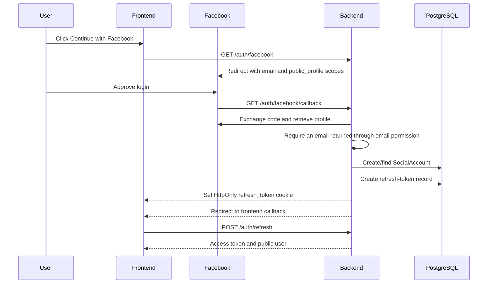

# Facebook Authentication Flow

## OAuth Flow



## Required Configuration

```env
FACEBOOK_APP_ID="..."
FACEBOOK_APP_SECRET="..."
FACEBOOK_CALLBACK_URL="http://localhost:4000/auth/facebook/callback"
FRONTEND_URL="http://localhost:3000"
CORS_ORIGINS="http://localhost:3000"
```

Register the callback in Meta:

```text
http://localhost:4000/auth/facebook/callback
```

Enable Facebook Login and request these permissions:

- `public_profile`
- `email`

The Facebook callback rejects accounts for which Graph API does not return an email.
