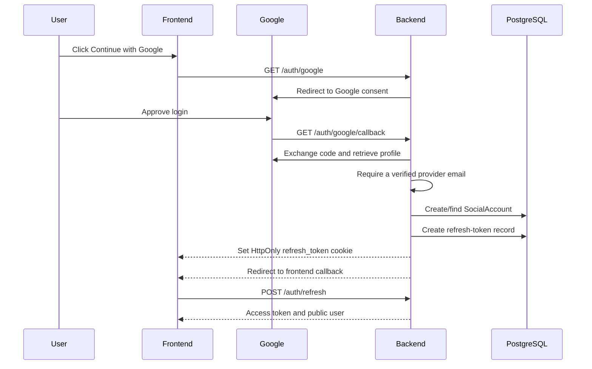

# Google Authentication Flow

## OAuth Flow



## Required Configuration

```env
GOOGLE_CLIENT_ID="..."
GOOGLE_CLIENT_SECRET="..."
GOOGLE_CALLBACK_URL="http://localhost:4000/auth/google/callback"
FRONTEND_URL="http://localhost:3000"
CORS_ORIGINS="http://localhost:3000"
```

Register the callback in Google Cloud:

```text
http://localhost:4000/auth/google/callback
```

Google must return a verified email. If verification is absent or a trusted identity cannot be established, the callback rejects authentication.
