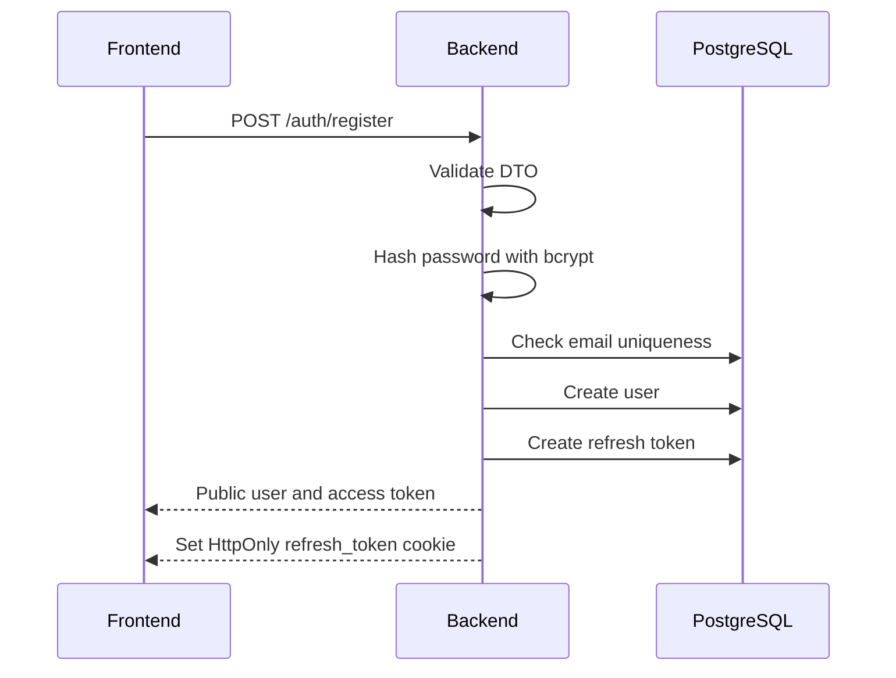
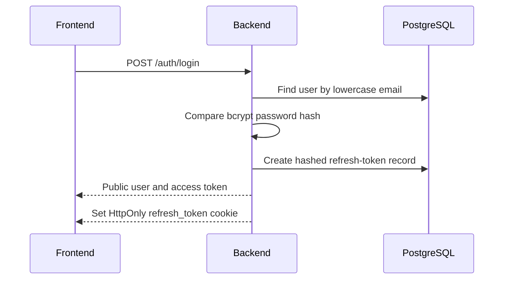

# Local Email and Password Authentication Flow

## Registration



### Request

```http
POST /auth/register
Content-Type: application/json

{
  "email": "user@example.com",
  "password": "minimum-8-characters",
  "name": "Optional name"
}
```

## Login



### Request

```json
{
  "email": "user@example.com",
  "password": "minimum-8-characters"
}
```

## Refresh and Logout

1. Frontend sends `POST /auth/refresh` with `credentials: "include"`.
2. Backend reads `refresh_token` from the HttpOnly cookie or the compatibility request body.
3. Backend atomically revokes the active refresh record and creates a replacement.
4. Frontend stores the returned access token in memory.
5. Logout revokes the refresh record and clears the cookie.

## Access Protected Routes

Send the access token:

```http
Authorization: Bearer <access-token>
```

`GET /auth/me` returns the current public user.
