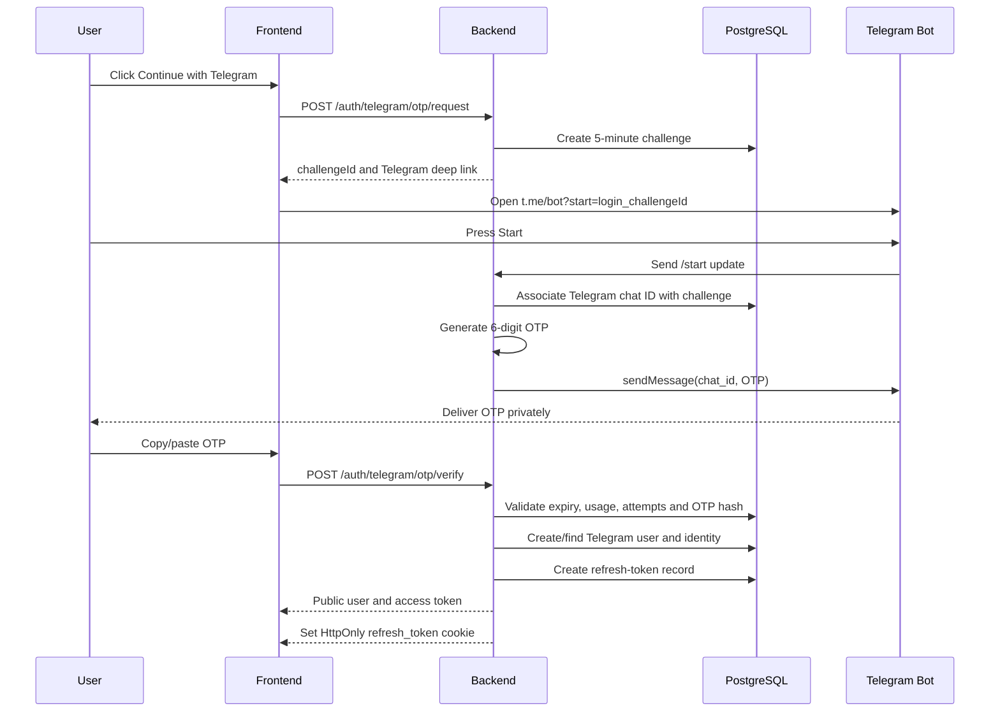

# Telegram Authentication Flow

## OTP Login Flow



## Request OTP

```http
POST /auth/telegram/otp/request
Content-Type: application/json

{}
```

Response:

```json
{
  "challengeId": "challenge-id",
  "expiresAt": "2026-11-19T17:30:00.000Z",
  "deepLink": "https://t.me/PersonalUniversalAgentBot?start=login_challenge-id"
}
```

## Verify OTP

```http
POST /auth/telegram/otp/verify
Content-Type: application/json

{
  "challengeId": "challenge-id",
  "code": "123456"
}
```

## Challenge Status

```http
GET /auth/telegram/otp/status/:challengeId
```

Possible status values:

- `waiting`: the bot has not received `/start`.
- `sent`: the bot has associated the chat and sent the OTP.
- `expired`: the challenge expired or was consumed.

## Required Configuration

```env
TELEGRAM_BOT_TOKEN="..."
TELEGRAM_BOT_USERNAME="PersonalUniversalAgentBot"
TELEGRAM_BOT_WEBHOOK_SECRET="long-random-secret"
```

## Local Development

When no webhook secret is configured, the backend can poll Telegram `getUpdates` and process `/start` updates locally.

Polling implementation:

- Runs every 1.5 seconds.
- Requests `message` updates.
- Processes `"/start login_<challengeId>"`.
- Deletes the webhook at startup in polling mode.

## Production

Configure a public HTTPS Telegram webhook:

```text
POST https://api.telegram.org/bot<BOT_TOKEN>/setWebhook
```

Webhook settings:

- URL: `https://api.example.com/auth/telegram/webhook`
- Header: `X-Telegram-Bot-Api-Secret-Token`
- Secret: the value of `TELEGRAM_BOT_WEBHOOK_SECRET`
