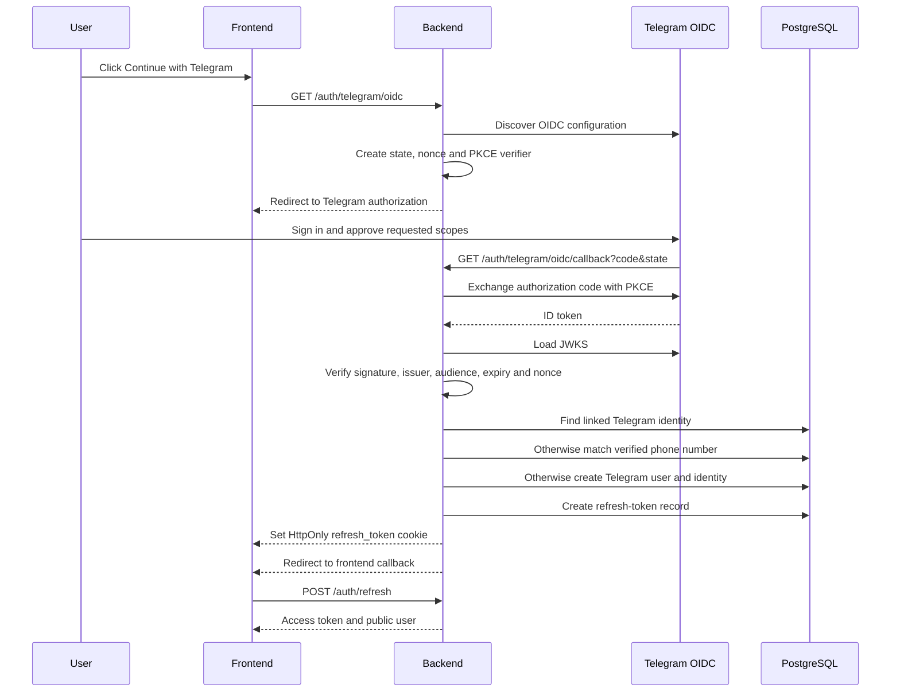

# Telegram OAuth/OIDC Authentication Flow

## OAuth/OIDC Flow



The existing Telegram OTP/deep-link flow remains available separately through
`/auth/telegram/otp/request`.

## Authorization Start

```http
GET /auth/telegram/oidc
```

The backend obtains Telegram's discovery document and redirects the browser to
the authorization endpoint with:

- `response_type=code`
- `scope=openid profile phone`
- `state`
- `nonce`
- PKCE `code_challenge` using `S256`

Telegram's implementation expects the callback parameter to be named
`redirect_url` rather than the conventional `redirect_uri`. The same exact
callback URL must be registered with Telegram and configured on the backend.

## Callback

```http
GET /auth/telegram/oidc/callback?code=<authorization-code>&state=<state>
```

The backend:

1. Validates the session state.
2. Exchanges the code at Telegram's token endpoint.
3. Verifies the ID token against Telegram's JWKS using `RS256`.
4. Validates `iss`, `aud`, `exp`, `sub`, and `nonce`.
5. Issues the normal application access token and HttpOnly refresh cookie.

The frontend receives the final redirect at:

```text
/auth/callback?authenticated=true
```

User cancellation or callback failures redirect with an error such as
`telegram_oidc_cancelled` or `telegram_oidc_failed`.

## Account Resolution

Telegram OIDC does not provide an email address. Email is never required for
this login method. The backend resolves accounts in this order:

1. Existing `SocialAccount` with provider `TELEGRAM` and matching `sub`.
2. Existing user with the verified `phone_number` claim, then link Telegram.
3. Create a new user with nullable email and link the Telegram identity.

## Telegram OIDC Endpoints

```text
Discovery: https://oauth.telegram.org/.well-known/openid-configuration
Authorization: https://oauth.telegram.org/auth
Token: https://oauth.telegram.org/token
JWKS: https://oauth.telegram.org/.well-known/jwks.json
```

## Required Configuration

```env
TELEGRAM_CLIENT_ID="..."
TELEGRAM_CLIENT_SECRET="..."
TELEGRAM_REDIRECT_URI="https://api.example.com/auth/telegram/oidc/callback"
FRONTEND_URL="http://localhost:3000"
```

Register the exact value of `TELEGRAM_REDIRECT_URI` in Telegram's OIDC client
configuration. For local development through an HTTPS tunnel, use the public
tunnel URL in both places.

The backend configuration is optional. If `TELEGRAM_CLIENT_ID` is unset,
Telegram OIDC is disabled while local auth, Google, Facebook, and Telegram OTP
continue to operate.

## Browser Requirements

The backend sends:

```http
Cross-Origin-Opener-Policy: same-origin-allow-popups
```

This allows Telegram's popup-based login to communicate with the opener. Do not
replace it with `same-origin` for this flow.
